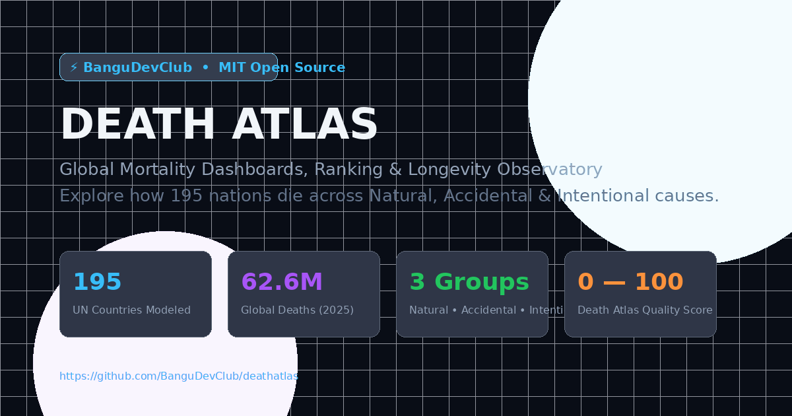

# Death Atlas

<p align="center">
  
</p>

<p align="center">
  <strong>Global Mortality Metric Dashboards, Ranking & Longevity Observatory (2025)</strong><br />
  An open-source MIT project by <strong><a href="https://github.com/BanguDevClub">BanguDevClub</a></strong>
</p>

<p align="center">
  <a href="https://github.com/BanguDevClub/deathatlas/blob/main/LICENSE"></a>
  <a href="https://astro.build"></a>
  <a href="https://react.dev"></a>
  <a href="https://tailwindcss.com"></a>
  <a href="https://github.com/catppuccin/catppuccin"></a>
  <a href="https://katex.org"></a>
  <a href="https://recharts.org"></a>
</p>

---

## 🧭 About Death Atlas

**Death Atlas** is an open-source, scientific public health observatory designed to inform humanity on **how people die across all 195 sovereign nations** in the year 2025.

Death is an inevitable biological culmination of human life. However, **how, when, and why people die** is a direct reflection of a society's healthcare infrastructure, technological safety, economic resilience, and peace. Death Atlas categorizes every death into three fundamental groups and grades every sovereign state using an algorithmic **Death Atlas Score ($S$)** ranging from `0.0` (worst) to `100.0` (optimal natural longevity).

Repository: [https://github.com/BanguDevClub/deathatlas](https://github.com/BanguDevClub/deathatlas)  
Base URL: `/deathatlas`

---

## 🌟 Key Features

- 🌍 **All 195 UN Sovereign Nations**: Covers 193 UN Member States plus the Holy See and the State of Palestine with 2025 population, crude death rates, and cause distributions.
- 🧬 **The Three Pillars of Mortality**:
  1. **Natural Deaths**: Old age / extreme senescence, cardiovascular & circulatory diseases, neoplasms (cancer), chronic respiratory, neurodegenerative (Alzheimer's), and infectious/communicable diseases.
  2. **External Accidental Deaths**: Road & transport crashes, occupational hazards, natural disasters, and accidental falls/poisonings/drownings.
  3. **External Intentional Deaths**: Interpersonal homicide, suicide & self-harm, armed conflict / war casualties, and collective terrorism.
- 📐 **Rigorous Mathematical Scoring**:
  - Perfect score **100.0**: Achieved if 100% of mortality occurs from natural old age / senescence.
  - Zero score **0.0**: Reached if 100% of deaths occur from intentional violence, slaughter, or war.
- 🎨 **6 Built-in Color Themes**:
  - **Midnight Dark** (Slate / Sky neon)
  - **Pure Light** (Crisp Zinc / Royal Blue)
  - **Catppuccin Latte** (Warm pastel light)
  - **Catppuccin Frappé** (Low-contrast dark)
  - **Catppuccin Macchiato** (Deep soothing medium-dark)
  - **Catppuccin Mocha** (Classic rich dark)
- ⚠️ **Data Transparency & CRVS Banners**:
  - Full disclosure on countries with incomplete Civil Registration & Vital Statistics (CRVS) or active warzones (e.g. Ukraine, Sudan, Palestine, Haiti, DR Congo).
  - Explicit warning alert banners indicating synthetic model estimations and the underlying reasons.
- 🧪 **Interactive Sandbox Simulator**:
  - Live scenario modeling: tweak sliders for any cause of death or pick presets like _"Universal Peace"_, _"Cure 50% Cancer"_, _"Eradicate Pathogens"_, or _"100% Old Age Utopia"_.
  - Instant live recalculation of the Death Atlas Score ($S$) and before/after delta charts.
- 📊 **Multi-Country Comparison**:
  - Juxtapose 2 or 3 countries side-by-side with radar charts, stacked group bars, and detailed taxonomy deltas.
- 💾 **Single Unified Dataset**:
  - All 195 countries gathered and classified in `src/data/deaths-2025.json` and exportable directly as JSON or CSV.

---

## 📑 Pages Breakdown

| Page            | URL Route                 | Description                                                                                                             |
| :-------------- | :------------------------ | :---------------------------------------------------------------------------------------------------------------------- |
| **Overview**    | `/deathatlas/`            | Hero showcase, key global mortality totals (62.6M deaths), taxonomy overview, and top/bottom rankings.                  |
| **Dashboard**   | `/deathatlas/dashboard`   | Deep-dive country dossiers with search, data confidence alerts, donut charts, and subcategory bars.                     |
| **Continents**  | `/deathatlas/continents`  | Comparative macro-demographics across Africa, Asia, Europe, North America, South America, and Oceania.                  |
| **Ranking**     | `/deathatlas/ranking`     | Sortable, searchable table of all 195 nations by score, deaths, death rate, and cause shares. Exportable to CSV & JSON. |
| **Compare**     | `/deathatlas/compare`     | Multi-country comparison tool featuring radar charts and side-by-side metrics.                                          |
| **Sandbox**     | `/deathatlas/sandbox`     | Counterfactual scenario simulator with real-time KaTeX formula recalculations.                                          |
| **Methodology** | `/deathatlas/methodology` | Scientific documentation, complete cause weightings ($w_i$), boundary proofs, and data sources.                         |

---

## 🧮 Mathematical Methodology

### 1. Partition Identity

Let $D_{\text{total}}$ be the total recorded and estimated deaths in a country during 2025. Every death is assigned to a mutually exclusive cause $i \in C$:

$$D_{\text{total}} = D_{\text{natural}} + D_{\text{accidental}} + D_{\text{intentional}} = \sum_{i \in C} D_i$$

### 2. Death Atlas Score Formula

Each cause $i$ carries an intrinsic quality-avoidability weight $w_i \in [0.0, 1.0]$. The composite index score $S$ is defined as:

$$S = 100 \times \sum_{i \in C} \left( w_i \cdot \frac{D_i}{D_{\text{total}}} \right)$$

### 3. Boundary Extremes

- **Ideal Longevity Ceiling**:
  $$\lim_{D_{\text{senescence}} \to D_{\text{total}}} S = 100 \times (1.00 \cdot 1.0) = 100.0$$
- **Intentional Violence Floor**:
  $$\lim_{D_{\text{intentional}} \to D_{\text{total}}} S = 100 \times (0.00 \cdot 1.0) = 0.0$$

### 4. Weighting Matrix ($w_i$)

| Classification                      | Category    | Weight ($w_i$) | Epidemiological Rationale                                                           |
| :---------------------------------- | :---------- | :------------: | :---------------------------------------------------------------------------------- |
| **Old Age & Senescence**            | Natural     |     `1.00`     | Optimal biological completion of human lifespan; zero premature trauma.             |
| **Neurodegenerative (Alzheimer's)** | Natural     |     `0.85`     | Pathologies of extreme advanced age (80+); correlates with high societal longevity. |
| **Neoplasms (Cancers)**             | Natural     |     `0.70`     | Primarily late-adulthood; partially treatable with modern oncology.                 |
| **Cardiovascular Diseases**         | Natural     |     `0.65`     | Circulatory wear-and-tear; leading global cause, treatable via preventive care.     |
| **Other Non-Communicable**          | Natural     |     `0.60`     | Chronic kidney, endocrine, autoimmune diseases.                                     |
| **Chronic Respiratory**             | Natural     |     `0.55`     | COPD, asthma; associated with airborne environmental exposure.                      |
| **Infectious & Communicable**       | Natural     |     `0.35`     | Tuberculosis, malaria, diarrheal pathogens; largely preventable via public health.  |
| **Natural Disasters**               | Accidental  |     `0.30`     | Earthquakes, extreme climate events; mitigable by civil engineering.                |
| **Occupational Hazards**            | Accidental  |     `0.20`     | Fatal workplace and construction trauma.                                            |
| **Falls, Drowning & Poisonings**    | Accidental  |     `0.18`     | Accidental domestic trauma, drownings, and overdoses.                               |
| **Road & Transport Crashes**        | Accidental  |     `0.15`     | Disproportionately kills youth (ages 15–29); preventable via infrastructure.        |
| **Suicide & Self-Harm**             | Intentional |     `0.06`     | Premature self-inflicted fatality; indicators of psychosocial gaps.                 |
| **Homicide & Violent Crime**        | Intentional |     `0.02`     | Interpersonal violent murder; severe human security failure.                        |
| **Armed Conflict & War**            | Intentional |     `0.00`     | Battlefield casualties, artillery strikes, civilian warfare deaths.                 |
| **Terrorism & Mass Attacks**        | Intentional |     `0.00`     | Deliberate collective attacks on non-combatants.                                    |

---

## 🔬 Data Sources & 2025 Synthesis

1. **United Nations Population Division**: World Population Prospects (WPP 2024/2025 Revision) for population headcounts, crude death rates (CDR), and life expectancies.
2. **World Health Organization (WHO)**: Global Health Estimates (GHE) baseline cause fractions and disease burden models.
3. **Institute for Health Metrics and Evaluation (IHME)**: Global Burden of Disease (GBD) Socio-demographic Index (SDI) covariates.
4. **Armed Conflict Location & Event Data Project (ACLED)** & **UN OCHA**: Real-time crisis tracking and 2024/2025 casualty assessments for active conflict theaters.

---

## 🛠️ Tech Stack

- **Framework**: [Astro 5](https://astro.build/)
- **UI Components**: [React 19](https://react.dev/) + [shadcn/ui design patterns](https://ui.shadcn.com/)
- **Styling**: [Tailwind CSS v4](https://tailwindcss.com/) with native `@theme` tokens
- **Data Visualization**: [Recharts](https://recharts.org/) (Doughnuts, Bar Charts, Radar, Benchmarks)
- **Mathematical Rendering**: [KaTeX](https://katex.org/)
- **Icons**: [Lucide React](https://lucide.dev/)
- **Package Manager**: npm

---

## 🚀 Getting Started

### Prerequisites

- Node.js `^18.20.8 || ^20.3.0 || >=22.0.0`
- npm package manager

### Installation

```bash
# Clone the repository
git clone https://github.com/BanguDevClub/deathatlas.git
cd deathatlas

# Install dependencies
npm install

# Start development server
npm run dev
```

Visit `http://localhost:4321/deathatlas/` in your browser.

### Building for Production

```bash
# Build static site to /dist
npm run build

# Preview production build locally
npm run preview
```

### Quality of Life & Developer Tooling

Death Atlas includes full toolchains for static typing, linting, code formatting, data pipeline automation, and validation:

| NPM Command               | Purpose                                                                             |
| :------------------------ | :---------------------------------------------------------------------------------- |
| `npm run typecheck`       | Validates TypeScript & Astro files using `astro check` with strict diagnostics.     |
| `npm run lint`            | Runs ESLint (flat config) across TypeScript and React source files.                 |
| `npm run lint:fix`        | Automatically fixes auto-fixable ESLint issues.                                     |
| `npm run format`          | Formats all source files, configurations, and markdown with Prettier.               |
| `npm run format:check`    | Verifies that all files conform to Prettier formatting guidelines.                  |
| `npm run validate`        | Runs `typecheck`, `lint`, and `format:check` in sequence (ideal for CI / pre-push). |
| `npm run data:generate`   | Re-executes the Python 2025 demographic synthesis pipeline and updates JSON files.  |
| `npm run assets:generate` | Re-generates high-resolution OG images (`og-image.png`) and vector icons.           |
| `npm run clean`           | Cleans up the `dist/` and `.astro/` build artifact caches.                          |

### Quality of Life & Developer Tooling

Death Atlas includes full toolchains for static typing, linting, code formatting, data pipeline automation, and validation:

| NPM Command               | Purpose                                                                             |
| :------------------------ | :---------------------------------------------------------------------------------- |
| `npm run typecheck`       | Validates TypeScript & Astro files using `astro check` with strict diagnostics.     |
| `npm run lint`            | Runs ESLint (flat config) across TypeScript and React source files.                 |
| `npm run lint:fix`        | Automatically fixes auto-fixable ESLint issues.                                     |
| `npm run format`          | Formats all source files, configurations, and markdown with Prettier.               |
| `npm run format:check`    | Verifies that all files conform to Prettier formatting guidelines.                  |
| `npm run validate`        | Runs `typecheck`, `lint`, and `format:check` in sequence (ideal for CI / pre-push). |
| `npm run data:generate`   | Re-executes the Python 2025 demographic synthesis pipeline and updates JSON files.  |
| `npm run assets:generate` | Re-generates high-resolution OG images (`og-image.png`) and vector icons.           |
| `npm run clean`           | Cleans up the `dist/` and `.astro/` build artifact caches.                          |

---

## 🤝 Contributing

Contributions from demographers, epidemiologists, frontend engineers, and data enthusiasts are welcome!

1. Fork the Project
2. Create your Feature Branch (`git checkout -b feature/NewMetric`)
3. Commit your Changes (`git commit -m 'Add NewMetric to 2025 methodology'`)
4. Push to the Branch (`git push origin feature/NewMetric`)
5. Open a Pull Request

---

## 📄 License

Distributed under the **MIT License**. See `LICENSE` for details.

---

<p align="center">
  Crafted with scientific rigor by <strong><a href="https://github.com/BanguDevClub">BanguDevClub</a></strong>.<br />
  <em>Death is inevitable; preventable and violent death is not.</em>
</p>
